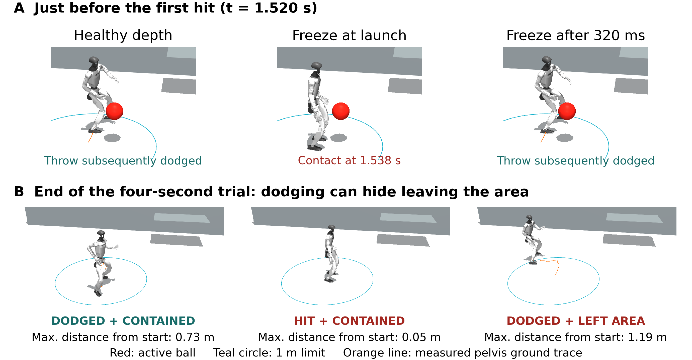
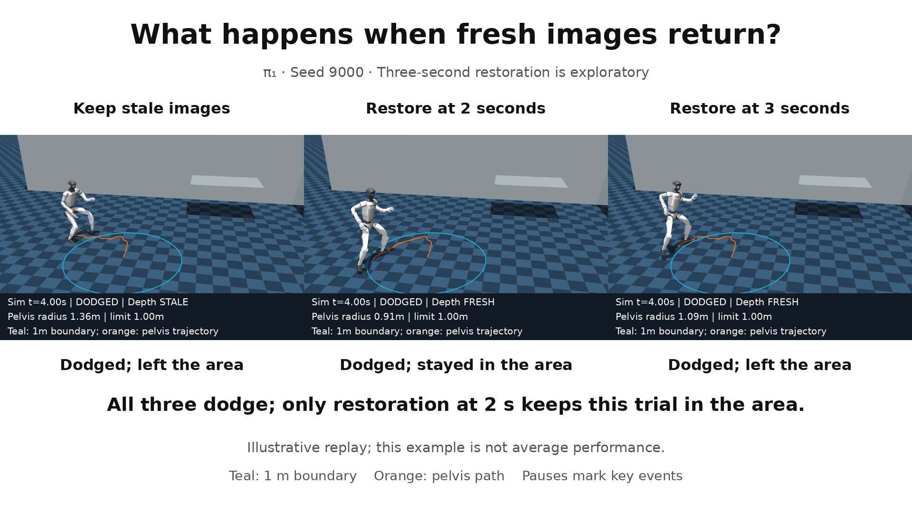
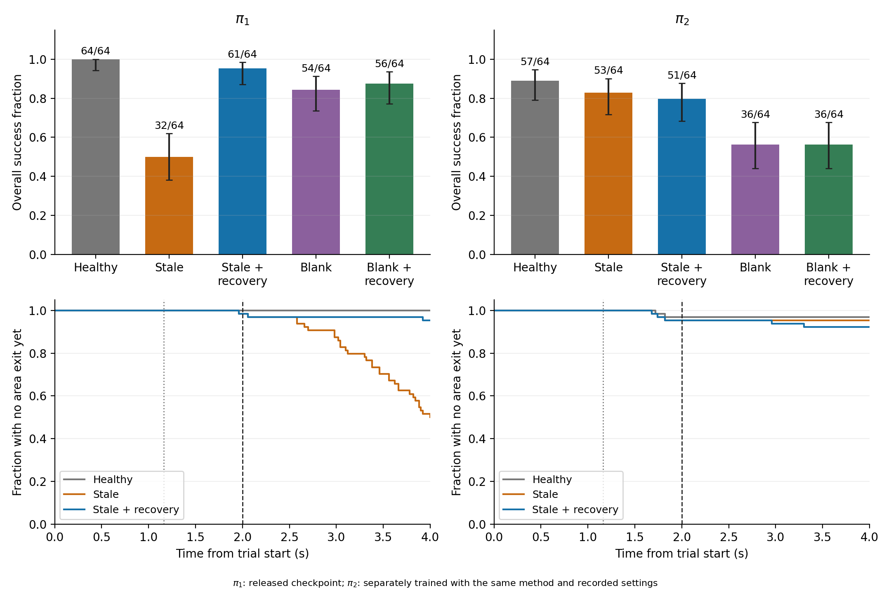
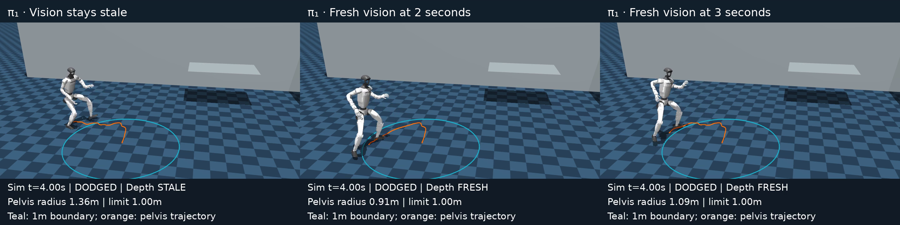

# Beyond Dodge Rate

Testing Humanoid Dodgeball Under Camera Failures

Kingston Kuan and Brandon Ong · Hebbian Robotics

A robot can dodge a ball and still leave its playing area. We evaluate camera
failures in simulated humanoid dodgeball, measuring contact, balance, and motion
after the encounter. Restoring fresh depth images after the throw improves area
compliance for one saved policy; the other responds differently.

We label the two saved policies **π₁** and **π₂**. π₁ is the released checkpoint;
π₂ was trained by Hebbian Robotics using the same method, architecture,
objective, and recorded settings. These labels identify fixed checkpoints.
The experiments compare camera interventions within each policy, rather than
ranking the policies. Their complete training histories are not available.

[Paper](paper/paper.pdf) · [Supplement](paper/supplement.pdf) · [Project website source](site/index.html) ·
[Reproduction instructions](docs/REPRODUCIBILITY.md) · [Methods](docs/METHODS.md)

This repository accompanies an unpublished research manuscript. Recorded trial
data and the separately trained weights have not been released; see
[availability](docs/AVAILABILITY.md).



*One illustrative throw, shown at matched times. A later camera freeze allows a
dodge, but the robot subsequently leaves the 1 m area. The orange line shows its
pelvis path. These exact replays illustrate the failure; they are not averages.*

## Video

[](https://youtu.be/MG4fqtBPVOY)

[Watch the 77-second overview on YouTube](https://youtu.be/MG4fqtBPVOY).
The captioned video compares
camera-failure timing, restoration of fresh images, and stale versus blank
depth. Separate tables report the measured results for both saved policies. Click the preview to open the video.

## Camera recovery

The recovery experiment uses a separate 160-trial pilot and 640-trial fixed
follow-up. Restoring fresh images at two seconds changes π₁ success
from 32/64 to 61/64 with 64/64 dodges in both conditions. π₂
shows no improvement in overall success (53/64 to 51/64). The fixed-cohort result is reported in the canonical manuscript. See the [recovery protocol](docs/CAMERA-RECOVERY-PROTOCOL.md)
and [reproduction](docs/REPRODUCIBILITY.md).



*All 640 fixed-cohort recovery trials. The top panels show success counts out of
64 seeds per condition, with Wilson 95% intervals. The bottom panels show the
fraction of trials that have not yet left the 1 m area. The primary paired
recovery comparison and its uncertainty are reported in the paper.*

[](site/assets/recovery-symbols.mp4)

*[Watch the recovery replay](site/assets/recovery-symbols.mp4). All three
robots dodge the same throw; only restoration at two seconds keeps this example
inside the area. This is the first declared recovery seed (9000), not average
performance. The video pauses at two seconds, three seconds, and the endpoint.*

## Camera-input comparison

Each row includes 192 test seeds. Success means dodging, staying upright, and
keeping the pelvis within 1 m of its starting position throughout four seconds.

| Saved policy | Camera input | Dodged | Overall success |
| --- | --- | --- | --- |
| π₁ | Healthy | 192/192 | 192/192 |
| π₁ | Stale | 191/192 | 70/192 |
| π₁ | Blank | 182/192 | 171/192 |
| π₂ | Healthy | 162/192 | 161/192 |
| π₂ | Stale | 165/192 | 158/192 |
| π₂ | Blank | 101/192 | 100/192 |

Blank instead of stale images changes success by +52.6 percentage points for
π₁ (95% paired interval +43.8 to +60.9) and −30.2 points for π₂ (−37.0 to −23.4).
No falls or aborted throws occurred in this comparison.

Blank images improve area compliance for both models. For π₁,
that improvement outweighs a small loss in dodges; for π₂, the loss in dodges
outweighs it. This describes the measured trade-off.
We have not established why the learned models respond differently.

Throws match exactly across camera conditions within each policy. They do not
match across policies, so these results compare input choices within a policy
and do not rank the policies overall. The original corrected study contains 2,496
trials. Six earlier cohorts are exploratory reanalyses; the main comparison uses
192 new held-out seeds per policy. Both training configurations used seed 42;
this is not a study of variation across repeated training runs.

## Controls and scope

A separate 640-trial [shared-trajectory control](docs/COMMON-THROW-CONTROL.md)
repeats both policies on identical recorded ball trajectories. The π₁
recovery benefit persists (23/64 to 60/64); π₂ shows no improvement
in overall success (46/64 to 45/64). This control is exploratory and is not pooled into the earlier
fixed recovery estimate.

The [recovery sensitivity analysis](docs/RECOVERY-SENSITIVITY.md) reports all
area and observation choices, plus distances without an area cutoff. For stale
images, restoration reduces π₁ mean maximum excursion by about
18 cm in both cohorts. π₂ can end closer to the station
without improving overall success. These are reanalyses of existing recordings.

A [later-restoration extension](docs/LATER-RECOVERY-PROTOCOL.md) adds 128 trials
on the same held-out seeds. π₁ success is 47/64 when fresh images
resume at three seconds, compared with 61/64 at two seconds and 32/64 without
restoration. This exploratory timing result is reported separately.

The manuscript source is `paper/main.tex`. See [the build instructions](docs/PAPER.md)
for named and anonymous PDF exports.

See [statistical scope](docs/STATISTICAL-SCOPE.md) for paired sample sizes,
uncertainty, and the distinction between evaluation seeds and training runs.

## Repository contents

- `scripts/`: evaluation, analysis, figure generation, and paper reproduction.
- `configs/`: declared scientific configurations for the original cohorts and extensions.
- `paper/`: manuscript, generated figure sources, and current PDF.
- `site/`: static project website, figures, and simulation videos.
- `docs/`: methods, provenance, and reproduction.
- `data/manifest.json`: hashes of the prepared scientific data package.

The scientific data packages are prepared locally and excluded from Git. See the
reproduction instructions for their contents and current availability. Simulator
inputs and model weights are obtained separately under their own licenses;
their bytes are not bundled in this repository.

## Code, data and weights

The evaluation and analysis code is included here. The four recorded-trial archives are prepared and hash-verified, but are not yet
publicly released or included in Git. Released reference weights are available
[from their original source](https://huggingface.co/nepyope/g1_depth_dodge/tree/10e207cb734a6c3edf792d4995ca59ae4641bf29);
the separately trained weights are not distributed.

Recomputing the reported statistics requires the trial archives. Rerunning all
simulations also requires the simulator assets and both sets of weights.
Public end-to-end reproduction is not currently available. See
[availability](docs/AVAILABILITY.md), [reproduction](docs/REPRODUCIBILITY.md), and
[model provenance](docs/PROVENANCE.md) for exact access and dependency details.

## Setup

```sh
uv sync --locked
uv run python scripts/reproduce.py --help
```

The analysis and typesetting run on CPU. New simulation trials additionally
require the pinned simulator assets and appropriate ONNX graphs. Reproducing
analysis from recorded trials does not require those weights.

## Attribution and license

The simulator and training implementation originate from
[G1 Depth Dodge by Martino Russi](https://github.com/nepyope/g1_sim_to_real),
building on [ViBe/ORCS](https://lok-i.github.io/vibe-control/), SONIC and Theia.
The deployment model uses [LeRobot](https://github.com/huggingface/lerobot) G1
assets. Our contribution is the controlled camera-failure evaluation and its
reported findings. See [provenance](docs/PROVENANCE.md) and [NOTICE](NOTICE).

Original evaluation and analysis code is licensed under [Apache-2.0](LICENSE).
The manuscript and its original figures are licensed under
[CC BY 4.0](paper/LICENSE.md).
Third-party software, models, meshes, and manuscript references retain their own
terms. See [contributing](CONTRIBUTING.md) for development checks and website
instructions.

The project website adapts the [Nerfies template](https://github.com/nerfies/nerfies.github.io).
Its presentation is CC BY-SA 4.0, with Bulma and Noto Sans under their own
licenses. See [website attribution](site/LICENSE.md).
