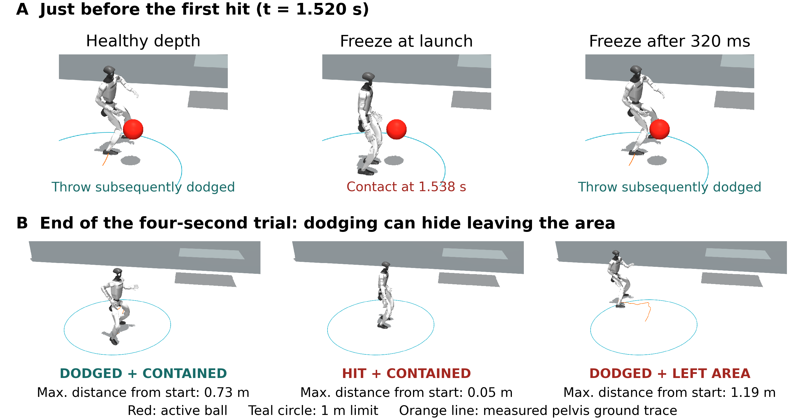
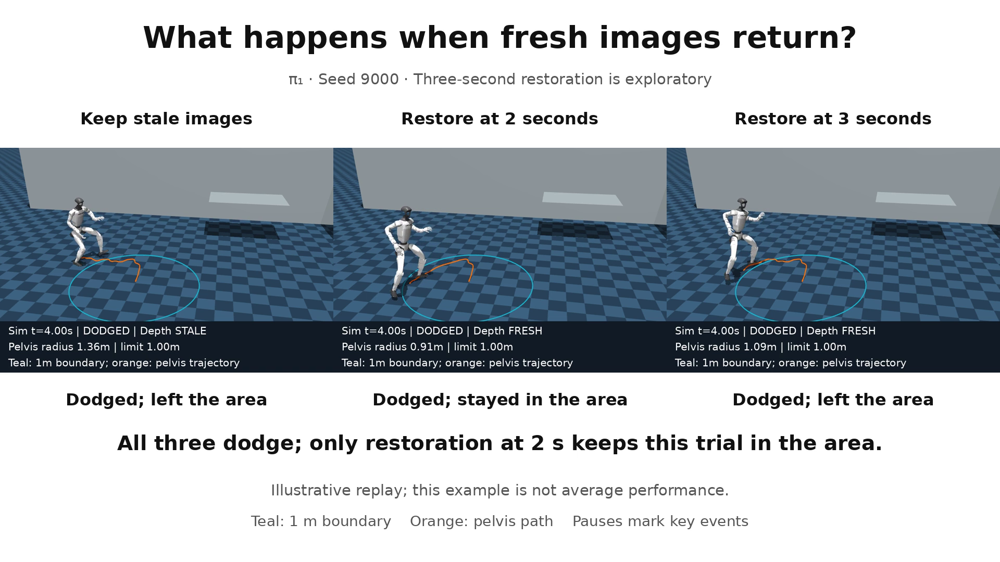
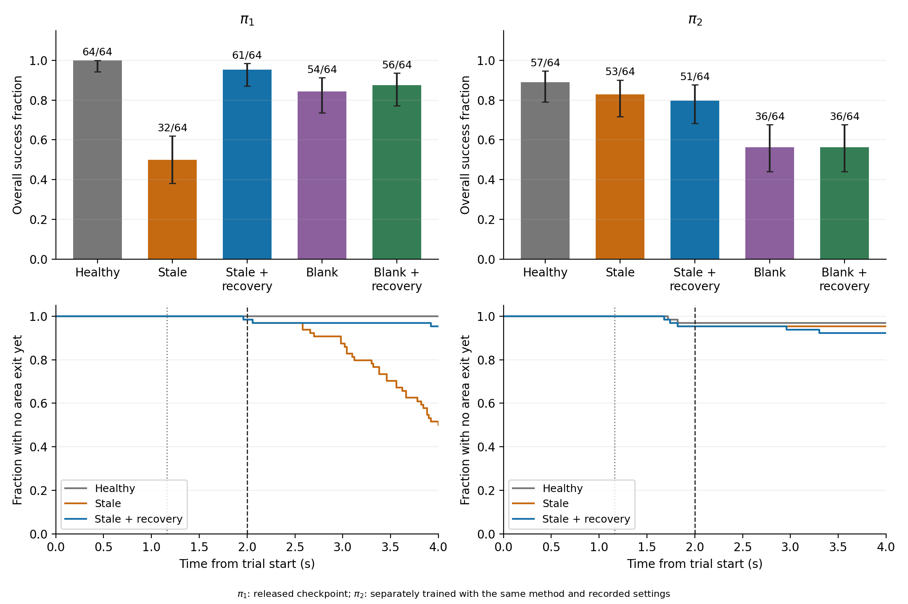
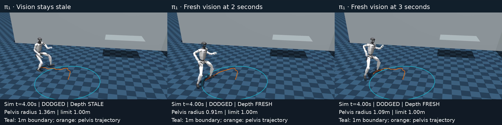

# Beyond Dodge Rate

Testing Humanoid Dodgeball Under Camera Failures

Kingston Kuan¹, Samuel J Chew², Khai Loong Aw³, Brandon Ong¹ · ¹Hebbian Robotics · ²Carnegie Mellon University · ³Stanford University

Accepted at [CoRL 2026 Workshop on RoboLetics](https://roboletics.github.io/corl2026/).

[Project page](https://hebbian-robotics.github.io/beyond-dodge-rate/) ·
[Paper](paper/paper.pdf) · [Supplement](paper/supplement.pdf) ·
[Video](https://youtu.be/iXgu4AaxdYE) ·
[Model](https://huggingface.co/hebbianrobotics/g1-depth-dodge) ·
[Data](https://huggingface.co/datasets/hebbianrobotics/beyond-dodge-rate) ·
[Reproduction](docs/REPRODUCIBILITY.md)

## Updates

- **Nov 2026**: Paper accepted at
  [CoRL 2026 Workshop on RoboLetics](https://roboletics.github.io/corl2026/).
  Code, paper, demo video, π₂ weights and trial data released.

## Overview

A robot can dodge a ball and still leave its playing area. We evaluate camera
failures in simulated humanoid dodgeball, measuring contact, balance, and motion
after the encounter. Restoring fresh depth images after the throw improves area
compliance for one saved policy; the other responds differently.

- **Dodging is not the whole outcome.** With stale depth images, π₁ dodges 191 of
  192 throws but stays in the area in only 70.
- **Restoring fresh images at two seconds** raises π₁ success from 32/64 to 61/64;
  π₂ shows no improvement (53/64 to 51/64).
- **Blank instead of stale images** changes success by +52.6 points for π₁ and
  −30.2 points for π₂, so camera handling should be tested on the policy in use.

The results are simulation-only, for two fixed checkpoints. They do not establish a
universal camera fallback or hardware safety.

We label the two saved policies **π₁** and **π₂**. π₁ is the released checkpoint;
π₂ was trained by Hebbian Robotics using the same method, architecture,
objective, and recorded settings. These labels identify fixed checkpoints.
The experiments compare camera interventions within each policy, rather than
ranking the policies. Their complete training histories are not available.

The recorded trial data and the separately trained π₂ weights are on Hugging Face;
see [availability](docs/AVAILABILITY.md). For definitions and protocols, start with
the [documentation index](docs/README.md).

## Quick start

Recompute the reported statistics and main figures from the recorded trials
(CPU only, no weights or simulator needed):

```sh
uv sync --locked
uvx --from huggingface_hub hf download hebbianrobotics/beyond-dodge-rate --repo-type dataset \
  --include "*.tar.gz" --local-dir data
uv run python scripts/analyze_original_study.py \
  --data data/evaluation-data.tar.gz --output outputs/reproduced
```

To verify the four original archives and the revision's separate stale-to-blank
control and rebuild the paper, see
[reproduction](docs/REPRODUCIBILITY.md).



*One illustrative throw, shown at matched times. A later camera freeze allows a
dodge, but the robot subsequently leaves the 1 m area. The orange line shows its
pelvis path. These exact replays illustrate the failure; they are not averages.*

## Video

[](https://youtu.be/iXgu4AaxdYE)

[Watch the 80-second overview on YouTube](https://youtu.be/iXgu4AaxdYE).
The captioned video compares
camera-failure timing, restoration of fresh images, and stale versus blank
depth. Separate tables report the measured results for both saved policies. Click the preview to open the video.

## Camera recovery

The recovery experiment uses a separate 160-trial pilot and 640-trial fixed
follow-up. Restoring fresh images at two seconds changes π₁ success
from 32/64 to 61/64 with 64/64 dodges in both conditions. π₂
shows no improvement in overall success (53/64 to 51/64). The fixed-cohort result is reported in the canonical manuscript. See the [recovery protocol](docs/CAMERA-RECOVERY-PROTOCOL.md)
and [reproduction](docs/REPRODUCIBILITY.md).



*All 640 fixed-cohort recovery trials. The top panels show success counts out of
64 seeds per condition, with Wilson 95% intervals. The bottom panels show the
fraction of trials that have not yet left the 1 m area. The primary paired
recovery comparison and its uncertainty are reported in the paper.*

[](site/assets/recovery-symbols.mp4)

*[Watch the recovery replay](site/assets/recovery-symbols.mp4). All three
robots dodge the same throw; only restoration at two seconds keeps this example
inside the area. This is the first declared recovery seed (9000), not average
performance. The video pauses at two seconds, three seconds, and the endpoint.*

## Camera-input comparison

Each row includes 192 test seeds. Success means dodging, staying upright, and
keeping the pelvis within 1 m of its starting position throughout four seconds.

| Saved policy | Camera input | Dodged | Overall success |
| --- | --- | --- | --- |
| π₁ | Healthy | 192/192 | 192/192 |
| π₁ | Stale | 191/192 | 70/192 |
| π₁ | Blank | 182/192 | 171/192 |
| π₂ | Healthy | 162/192 | 161/192 |
| π₂ | Stale | 165/192 | 158/192 |
| π₂ | Blank | 101/192 | 100/192 |

Blank instead of stale images changes success by +52.6 percentage points for
π₁ (95% paired interval +43.8 to +60.9) and −30.2 points for π₂ (−37.0 to −23.4).
No falls or aborted throws occurred in this comparison.

Blank images improve area compliance for both models. For π₁,
that improvement outweighs a small loss in dodges; for π₂, the loss in dodges
outweighs it. This describes the measured trade-off.
We have not established why the learned models respond differently.

Throws match exactly across camera conditions within each policy. They do not
match across policies, so these results compare input choices within a policy
and do not rank the policies overall. The original corrected study contains 2,496
trials. Six earlier cohorts are exploratory reanalyses; the main comparison uses
192 new held-out seeds per policy. Both training configurations used seed 42;
this is not a study of variation across repeated training runs.

## Controls and scope

A separate 640-trial [shared-trajectory control](docs/COMMON-THROW-CONTROL.md)
repeats both policies on identical recorded ball trajectories. The π₁
recovery benefit persists (23/64 to 60/64); π₂ shows no improvement
in overall success (46/64 to 45/64). This control is exploratory and is not pooled into the earlier
fixed recovery estimate.

The [recovery sensitivity analysis](docs/RECOVERY-SENSITIVITY.md) reports all
area and observation choices, plus distances without an area cutoff. For stale
images, restoration reduces π₁ mean maximum excursion by about
18 cm in both cohorts. π₂ can end closer to the station
without improving overall success. These are reanalyses of existing recordings.

A [later-restoration extension](docs/LATER-RECOVERY-PROTOCOL.md) adds 128 trials
on the same held-out seeds. π₁ success is 47/64 when fresh images
resume at three seconds, compared with 61/64 at two seconds and 32/64 without
restoration. This exploratory timing result is reported separately.

The manuscript source is `paper/main.tex`. See [the build instructions](docs/PAPER.md)
for named and anonymous PDF exports.

See [statistical scope](docs/STATISTICAL-SCOPE.md) for paired sample sizes,
uncertainty, and the distinction between evaluation seeds and training runs.

## Repository contents

- `scripts/`: evaluation, analysis, replay rendering, and paper reproduction.
- `demo/`: builder for the overview video, with its bundled fonts.
- `configs/`: declared scientific configurations for the original cohorts and extensions.
- `paper/`: manuscript source and current PDFs.
- `site/`: static project website, figures, and simulation videos.
- `docs/`: methods, provenance, and reproduction ([index](docs/README.md)).
- `data/`: archive manifests and frozen input hashes. The archives themselves are
  excluded from Git.
- `results/`: summary counts used by the website and demo, and the publication file hashes.

## Data, weights and requirements

| Material | Where |
| --- | --- |
| Four recorded-trial archives (4,064 trials) | [Hugging Face dataset](https://huggingface.co/datasets/hebbianrobotics/beyond-dodge-rate), hash-verified against `data/` |
| Stale-to-blank control (384 trials) | Analysis code, configurations, reference results, and archive hashes are included; recorded-trial release pending. See [reproduction](docs/REPRODUCIBILITY.md#stale-to-blank-control). |
| π₁ weights (released checkpoint) | [Original release](https://huggingface.co/nepyope/g1_depth_dodge/tree/10e207cb734a6c3edf792d4995ca59ae4641bf29) |
| π₂ weights (separately trained) | [hebbianrobotics/g1-depth-dodge](https://huggingface.co/hebbianrobotics/g1-depth-dodge) |
| Simulator and robot assets | Obtained from the original sources under their own licenses |

Recomputing the reported statistics needs only the trial archives, and the analysis
and typesetting run on CPU. Running new simulation trials also needs the simulator
assets and both sets of weights. See [availability](docs/AVAILABILITY.md),
[reproduction](docs/REPRODUCIBILITY.md), and [model provenance](docs/PROVENANCE.md).

## Attribution and license

The simulator and training implementation originate from
[G1 Depth Dodge by Martino Russi](https://github.com/nepyope/g1_sim_to_real),
building on [ViBe/ORCS](https://lok-i.github.io/vibe-control/), SONIC and Theia.
The deployment model uses [LeRobot](https://github.com/huggingface/lerobot) G1
assets. Our contribution is the controlled camera-failure evaluation and its
reported findings. See [provenance](docs/PROVENANCE.md) and [NOTICE](NOTICE).

Original evaluation and analysis code is licensed under [Apache-2.0](LICENSE).
The manuscript and its original figures are licensed under
[CC BY 4.0](paper/LICENSE.md).
Third-party software, models, meshes, and manuscript references retain their own
terms. See [contributing](CONTRIBUTING.md) for development checks and website
instructions.

The project website adapts the [Nerfies template](https://github.com/nerfies/nerfies.github.io).
Its presentation is CC BY-SA 4.0, with Bulma and Noto Sans under their own
licenses. See [website attribution](site/LICENSE.md).
